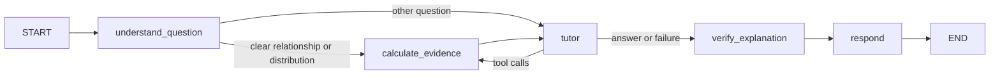

# HealthLens

A conversational teacher for tabular healthcare data. Upload CSV/XLSX, ask a question, learn from an explanation backed by computed evidence and an interactive ECharts visualization, then ask a follow-up.

## Architecture

The primary path is **LangChain tools + LangGraph + a selectable Groq/Gemini chat model**. PandasAI is retained as an optional backend; it does not handle the default educational conversation.



- `core/education.py`: shared conversation state, bounded tool rounds, teaching prompt, evidence checks and graceful fallback.
- `core/teaching_tools.py`: typed LangChain tools; ToolRuntime injects the dataset and ToolNode executes requests.
- `core/analytics.py`: deterministic relationship statistics, missing-value handling, distributions, comparisons and chart data.
- `core/models.py`: provider/model selection. Default hosted configuration is Groq GPT-OSS 120B; Gemini remains selectable.
- `core/grounding.py`: conservative checks for known unsupported claims, such as treating correlation as a per-hour effect. This is not a comprehensive factual validator.
- `core/query.py`: read-only DuckDB queries against the in-memory table `healthcare`, with external access disabled, a memory limit and a query deadline.
- `static/charts.js`: interactive ECharts built from calculated data, with tooltips, zoom and image download. No model-generated plotting code is executed on this path.
- `core/pandasai_workflow.py` and `core/analysis.py`: retained optional PandasAI/Docker path.

Plain, unfiltered relationships and distribution requests can go directly to a calculation tool, followed by one explanatory model call. Other questions use a model → tools → explanation flow. At most two tool rounds and three model calls are allowed. Provider retries are disabled and individual model requests are bounded. If the model fails after a calculation, the evidence and chart remain available with a calculation-based explanation. Certain failed grounding checks also use this explicit fallback.

Conversation history includes the previous questions, answers and tool evidence, scoped to the browser's dataset. Four turns are retained and restored on refresh. This is in-memory conversational state, not a durable LangGraph checkpoint. Progress updates stream to the browser as NDJSON.

## Run locally

Use Python 3.11 while the optional PandasAI dependency remains installed.

```powershell
uv venv --python 3.11 .venv
uv pip install --python .venv\Scripts\python.exe -r requirements.txt
npm ci
npm run assets
Copy-Item .env.example .env
# Set GROQ_API_KEY, or choose LLM_PROVIDER=gemini and set GOOGLE_API_KEY
.\start.ps1
```

Open http://127.0.0.1:5000. The default educational path does not require Docker. Select `ANALYSIS_BACKEND=pandasai` only to use the retained legacy backend, which requires Docker Desktop's Linux engine and the Gemini configuration used by its adapter. Never commit API keys or put them in browser code.

## Hosted deployment

Vercel serves the website and Node gateway. The Python backend runs in a persistent Vercel Sandbox. The gateway authenticates using Vercel OIDC and protects the backend with a server-only proxy secret. Keys stay in Vercel secret settings. The current sandbox name is `healthlens-education`.

Configure `LLM_PROVIDER`, `GROQ_API_KEY`, `GROQ_MODEL`, `GOOGLE_API_KEY`, `GEMINI_MODEL`, `APP_PROXY_SECRET`, `SESSION_SECRET`, and `HEALTHLENS_SANDBOX_NAME` on the server as appropriate. Changing `LLM_PROVIDER` and the corresponding model setting switches the chat provider without changing the graph.

Hobby sandbox sessions last up to 45 minutes and resume on demand within account quotas. Cold resumes restart the Python service; in-memory uploads and history must then be loaded again. The deployment snapshot includes dependencies but not live process memory. Python changes require uploading the allowlisted backend source and saving a fresh snapshot; pushing a website-only change deploys it through GitHub automatically. `cloud/start.sh` checks the deployment revision before starting the backend.

## Scope and limits

- Education and descriptive exploration, not treatment decisions. Model prose still requires review; evidence checks are not a guarantee of correctness.
- CSV/XLSX, first Excel worksheet, up to 100,000 rows and 150 columns. File limit: 10 MB locally, 4 MB hosted.
- Missing/nonfinite pairs are excluded explicitly; no automatic imputation. Relationship plots show at most 2,000 points, with statistics computed over all complete pairs.
- Numeric pie charts use labeled equal-width bins, not clinical thresholds. Table previews/exports include at most 200 rows.
- Maximum eight active in-memory datasets; two-hour inactivity expiry. New uploads clear that browser's prior conversation. Restarting the service clears uploads and conversation.
- Model requests include schema and computed summaries; query result previews may include dataset values. Use public or synthetic teaching datasets for this prototype.
- Groq and Gemini both have request/token quotas. One question can require multiple model requests; no automatic paid-provider fallback is configured.

## Verify

```powershell
.venv\Scripts\python.exe -m unittest discover -s tests -v
.venv\Scripts\python.exe tests\browser_check.py
# Opt-in live API test, using synthetic data:
.venv\Scripts\python.exe tests\live_education.py
```

Tests cover the exact heart-rate/sleep relationship question, follow-up state, counted age pies, missing/nonfinite data, bounded tool loops, timeout fallbacks, grounding failures, uploads, isolation and streaming. Browser tests use a simulated model with real calculations and check interactive scatter/pie charts, refresh memory, sanitized Markdown and mobile layout. The retained PandasAI adapter has its own mocked-provider contract test. Live tests are explicitly separate from deterministic tests.

## Documentation consulted

- [LangGraph quickstart](https://docs.langchain.com/oss/python/langgraph/quickstart)
- [LangChain tools and ToolRuntime](https://docs.langchain.com/oss/python/langchain/tools)
- [LangChain Groq integration](https://docs.langchain.com/oss/python/integrations/chat/groq)
- [LangChain Gemini integration](https://docs.langchain.com/oss/python/integrations/chat/google_generative_ai)
- [Groq models](https://console.groq.com/docs/models) and [limits](https://console.groq.com/docs/rate-limits)
- [PandasAI Agent](https://docs.pandas-ai.com/v3/agent)
- [Vercel Sandbox](https://vercel.com/docs/sandbox)
