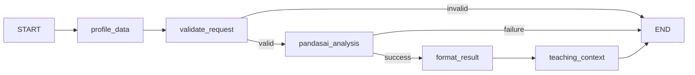

# HealthLens

A local teaching app for exploring tabular healthcare datasets with **LangGraph + PandasAI + Gemini 3.6 Flash**. Upload CSV/XLSX, inspect a data profile, ask questions, and download Matplotlib charts or result tables. Includes invented classroom data to explore without an upload.

## Hosted deployment

The Vercel website serves static assets and a Node API gateway. The Python LangGraph/PandasAI app runs in a persistent Vercel Sandbox with its own Docker engine. The gateway authenticates to that project using Vercel OIDC; backend access requires a server-only proxy secret. Gemini credentials are stored as Vercel secrets, never in GitHub or browser code.

The hosted upload limit is 4 MB. A cold backend resumes its saved filesystem and restarts its services; in-memory datasets must be uploaded again after that restart. Hobby sandbox sessions last up to 45 minutes and resume on demand, within account quotas. The deployment snapshot contains Python dependencies and the analysis image, but no uploaded datasets. Future backend changes require updating the sandbox source and saving a fresh snapshot as well as deploying the website.

Build the website with `npm ci` and `npm run build`. `cloud/start.sh` starts the backend after a sandbox resume. `cloud/PandasAI.Dockerfile` builds the execution image in the cloud. Configure `GOOGLE_API_KEY`, `GEMINI_MODEL`, `APP_PROXY_SECRET`, `SESSION_SECRET`, and `HEALTHLENS_SANDBOX_NAME` as server-side Vercel environment variables.

## Run

Use Python **3.11**. PandasAI 3.0.0 constrains older scientific packages; the project environment keeps these separate from your system Python.

```powershell
uv venv --python 3.11 .venv
uv pip install --python .venv\Scripts\python.exe -r requirements.txt
Copy-Item .env.example .env
# Edit .env and set GOOGLE_API_KEY
.\start.ps1
```

Open http://127.0.0.1:5000. Start Docker Desktop with its Linux engine before asking an AI question. The first question may download PandasAI's execution image. No API key is required for uploads, previews, or the sample dataset. API keys stay on the server; never put one in frontend code or commit .env.

## Workflow



`core/workflow.py` defines typed shared state and individually replaceable nodes. `build_graph(backend=...)` accepts any backend implementing `analyze(frame, question, history)`. `core/analysis.py` is the PandasAI adapter, configures Gemini through LiteLLM, and runs generated code in PandasAI's DockerSandbox. There is no direct generated-code execution fallback.

PandasAI currently owns its internal code-generation and retry loop. LangGraph owns the surrounding application workflow. To split generation/execution into graph nodes later, extend the backend interface instead of changing the web UI. History is scoped to a dataset in a browser session and reconstructed into each request; it is not a durable LangGraph checkpoint. `langgraph.json` exposes the graph for development tooling (install langgraph-cli separately if needed).

## Scope and limitations

- Descriptive education and exploration. AI results require review; prompts are guidance, not a guarantee of correctness or medical scope.
- CSV and XLSX only; Excel uses the first worksheet. Maximum 10 MB, 100,000 rows, 150 columns.
- Uploaded data stays in server memory for up to two hours of inactivity, is replaced on new upload, and disappears on restart. Maximum eight active datasets. PandasAI may write local logs/artifacts; do not use this prototype for confidential records.
- Model requests may include table metadata/sample data. Use public or synthetic teaching data with the free Gemini tier.
- Matplotlib charts are static PNGs. Table previews/exports include at most 200 result rows.
- Docker must be running; generated analysis is never executed directly on the host.
- This is a localhost prototype, not a multi-user deployment. The browser UI and fonts run locally.
- Live Gemini 3.6 Flash testing passed on 15 November 2026 with synthetic data: the mean age matched the direct calculation, and the full workflow produced a labeled Matplotlib histogram. Model availability and quotas depend on your Google project.

## Verify

```powershell
.venv\Scripts\python.exe -m unittest discover -s tests -v
node --check static/app.js
```

Tests exercise the real LangGraph routing with an injected backend, file uploads, missing-value preservation, chart response normalization, browser-session isolation, history, and missing-key handling. They do not pretend to validate live model output.

An additional contract test uses the actual installed PandasAI Agent and LiteLLM adapter with a simulated provider response and execution container. It checks the generated-code handoff and real restricted SQL calculation. `tests/browser_check.py` runs a temporary local server and checks desktop/mobile layouts using Playwright (optional development dependency).

`requirements.lock.txt` records the verified Windows/Python 3.11 environment, including optional browser-check dependencies. Use it to reproduce the installed versions. The shorter `requirements.txt` lists application dependencies.

## Documentation checked

- [LangGraph Graph API](https://docs.langchain.com/oss/python/langgraph/graph-api)
- [PandasAI Agent and sandbox](https://docs.pandas-ai.com/v3/agent)
- [PandasAI LiteLLM configuration](https://docs.pandas-ai.com/v3/large-language-models)
- [PandasAI source and Python requirements](https://github.com/sinaptik-ai/pandas-ai)
- [Gemini API pricing and model IDs](https://ai.google.dev/gemini-api/docs/pricing)

PandasAI core is MIT licensed; enterprise directories use separate terms. This project uses its core Agent and Docker integration.
