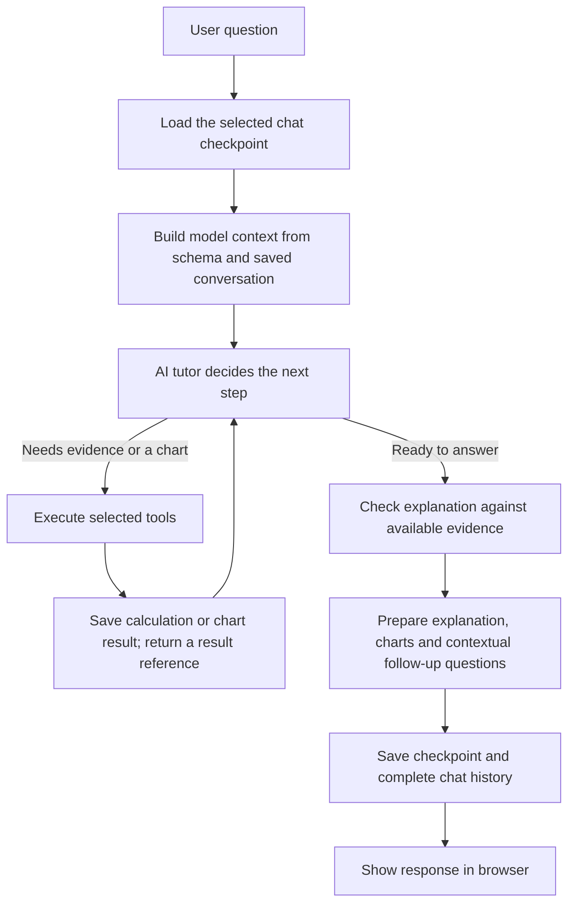

# HealthLens: question-to-answer architecture

Status: implementation in progress; deployment and acceptance checks are pending. This document will be updated after verification.

HealthLens is a conversational tool for teaching and exploring tabular healthcare data. Its AI chooses small calculation and chart tools, rather than relying on fixed analysis workflows. It is not a diagnosis or treatment system.

## Steps

1. **Question arrives:** the browser sends the question to Flask through the Vercel API gateway. The browser session identifies the dataset and selected chat.
2. **Load memory:** LangGraph restores that chat's saved checkpoint. Each chat has a separate thread identifier. Dataset tables and full calculated results are stored separately from graph state.
3. **Build context:** the model receives dataset metadata, recent messages and compact, relevant earlier context. Limiting model input does not delete saved conversation history.
4. **Choose tools:** the model uses each tool's description and input schema to choose operations and arguments. The backend validates the arguments and performs calculations.
5. **Execute and loop:** tools return computed facts and saved result references. The AI can call another tool using an earlier result reference, then continue until it has enough evidence or reaches execution limits.
6. **Prepare the response:** the app packages a plain-language explanation, chart specifications and useful next questions. A limited consistency check flags selected unsupported claims; it is not a guarantee that every sentence is correct.
7. **Save and display:** checkpoints and full response history are saved. The browser renders Markdown and interactive Apache ECharts charts.

## Tools

| Tool | Job |
|---|---|
| Inspect dataset | Column names, types, missing values and summaries |
| Query data | Read-only SQL filtering, grouping and aggregation |
| Calculate statistics | Count, sum, mean, median, min/max, standard deviation, variance, quantiles, frequencies, percentages, Pearson and Spearman correlations |
| Scatter plot | Plot two measurements, optionally grouped by a category |
| Pie chart | Show category counts or numeric-bin shares |
| Bar chart | Compare computed category values |
| Line chart | Plot ordered result rows |
| Histogram | Show counts across numeric bins |
| Box plot | Show the five-number summary with full-range whiskers |
| Correlation heatmap | Visualize an already calculated pairwise correlation matrix |

Calculation tools do not automatically draw charts. The AI requests charts separately, using dataset columns or a saved result reference. Pairwise correlations can involve several selected columns, but do not adjust for other variables.

## Memory

- Native LangGraph checkpoints preserve messages and execution state per chat.
- SQLite stores checkpoints, datasets, analysis results and full displayed responses locally.
- Hosted workspaces are backed up to private Vercel Blob storage so they can be restored outside a temporary backend server.
- Full saved history and bounded model context are different: earlier conversation can be summarized/retrieved without deleting the original.
- New chat starts a separate thread. Clear chat removes that thread's conversation and calculated-result memory while keeping the dataset.

## Follow-up questions

The AI proposes zero to three specific next questions alongside its answer, based on the question, evidence, dataset columns and recent conversation. The app removes repeated or unsupported suggestions. There is no universal fixed list below every response.

## Limits

This version supports exploratory summaries, pairwise correlations and descriptive group comparisons. It does not provide regression, significance testing, independent-effect estimates or causal conclusions. Tool calls and execution time are bounded; incomplete work must be disclosed. Saved memory does not guarantee perfect recall by the model.

## Technology

HTML/CSS/JavaScript, Apache ECharts, Python Flask, LangChain, LangGraph, Pandas, NumPy, SciPy and DuckDB. Groq/Gemini provide the language model. Vercel hosts the frontend and API gateway; Vercel Sandbox runs Python. Private Vercel Blob stores hosted workspace backups.
