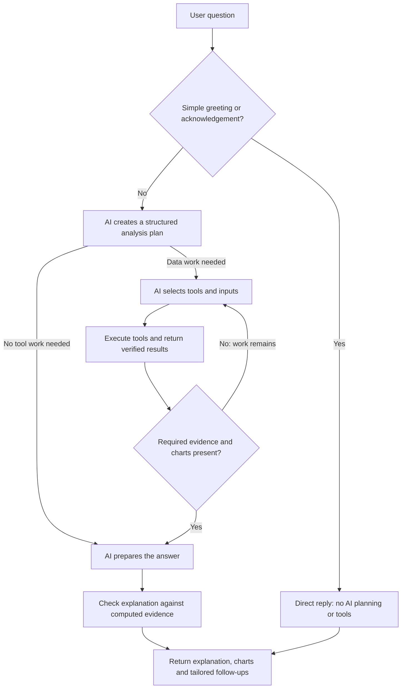

# HealthLens: AI architecture and analysis flow

Status: final implementation checks are in progress. The graph described below is implemented; the final hosted acceptance check is pending.

HealthLens helps users understand tabular healthcare data through explanations and interactive visualizations. Its AI plans the work and combines small tools instead of routing every question through a fixed analysis function.

## How a question becomes an answer

1. **Route the request.** Greetings and acknowledgements take a direct path with no model or analysis calls. For other questions, the backend supplies the question, dataset schema and relevant conversation context. The AI sees column names and types; calculation tools access the actual table.
2. **Create a structured plan.** The AI selects an intent and a list of supported tool steps, including whether calculations and a visualization are needed. Plans cannot contain arbitrary analysis instructions. Dataset overviews require inspection. New relationship analyses require both computed evidence and a supporting chart.
3. **Select and execute tools.** The AI chooses tools using their descriptions and defined input schemas. The backend validates inputs, performs the calculations and returns actual results. Tool calls are managed inside LangGraph through a ToolNode.
4. **Continue the reasoning loop.** After a tool result, the graph checks required work and returns to AI tool selection only when work remains. For example, it calculates a correlation matrix first, then passes the saved result reference to the heatmap tool. Calculations do not automatically create charts.
5. **Check task completion.** Before returning a final answer, the graph checks whether required calculations and charts actually completed. If work is missing, it restricts tool selection to the remaining required capabilities. Valid dataset-scoped inspection results can be reused because the dataset is immutable within that chat. Execution limits prevent endless loops; unfinished work must be disclosed.
6. **Prepare the response.** A separate AI call, without tool definitions, produces a structured explanation and follow-up questions from computed evidence and the actual chart metadata, without inheriting interpretation instructions from the plan. This keeps tool execution separate from answer generation and reduces repeated tool-schema tokens. The AI explains the findings and limitations. A limited evidence-consistency check flags selected unsupported claims. The application renders the explanation and real chart artifacts, plus zero to three question-specific follow-up suggestions.

## Tools available to the AI

| Tool | Purpose |
|---|---|
| Inspect dataset | Identify columns, types, missing values and descriptive summaries |
| Query data | Run read-only SQL for filtering, grouping and aggregation |
| Calculate statistics | Count, sum, mean, median, min/max, standard deviation, variance, quantiles, frequencies, percentages, Pearson and Spearman correlations |
| Scatter plot | Show two measurements as points, optionally grouped by a category |
| Pie chart | Show category counts or shares of numeric bins |
| Bar chart | Compare calculated category values |
| Line chart | Visualize ordered result rows |
| Histogram | Show numeric values grouped into ranges |
| Box plot | Show a five-number summary with full-range whiskers |
| Correlation heatmap | Visualize a previously calculated pairwise correlation matrix |

The AI chooses what to do; tools perform the mathematics. Charts use validated dataset columns or saved calculation results, not numbers invented by the AI.

## Example: glucose, BMI, age, insulin and diabetes

The AI plans an exploratory comparison, calculates appropriate pairwise correlations, requests a heatmap and explains the findings. It may also calculate group summaries and request a bar chart. These are separate tool calls selected for that question, rather than a special fixed workflow for those five columns.

Pairwise correlations do not isolate each variable's independent association. This version does not perform regression, significance testing or causal analysis, and does not provide diagnosis or treatment advice.

## State and supporting infrastructure

**State** is the shared working notebook across graph nodes: question, plan, messages, dataset metadata, tool-result references and completion status. The dataset is supplied to tools through runtime context. Conversation context is supported by per-chat checkpoints; full datasets and calculated results are stored separately. Persistence supports the AI flow but is not the central analysis mechanism.

## Follow-up suggestions

Suggested next questions are generated with the answer using the current question, evidence, available columns and recent conversation. Repeated or unsupported suggestions are filtered. They are not a universal fixed set of buttons.

## Technology and limits

The AI workflow uses LangGraph and LangChain, with Groq or Gemini as the model provider. Pandas, NumPy, SciPy and DuckDB calculate results; Apache ECharts renders charts. Flask handles requests, and Vercel hosts the application.

Schema validation and completion checks improve reliability but do not prove every generated sentence correct. The computed evidence remains available for inspection. Tool calls and execution time are bounded, and provider outages or incomplete work are reported rather than presented as a finished analysis.
